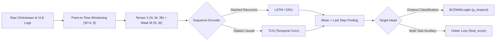

# 🎓 OULAD Early Warning & Algorithmic Fairness Suite

> **Production Machine Learning Suite for Student Attrition Early Warning, Continuous Risk Trajectories, Deep Sequence Modeling, and Algorithmic Fairness Auditing on the Open University Learning Analytics Dataset (OULAD).**

---

## 📌 Executive Summary

Predicting student attrition in distance higher education is characterized by severe class imbalance, evolving temporal dynamics, and complex student engagement patterns. This repository implements a multi-stage machine learning system that tracks learner risk across course weeks without data leakage, comparing classical tabular baselines, tree ensembles, and deep neural sequence models.

### Key Capabilities:
- **Zero-Leakage Point-in-Time Feature Engineering**: 38 snapshot-safe features capturing static learner context, clickstream behavior, assessment trajectory, and curriculum pacing.
- **Deep Sequence Architectures (Phase 4)**: Bidirectional/stacked LSTM, GRU, and Temporal Convolutional Networks (TCN) processing multi-week temporal clickstream tensors with masking and multi-task learning.
- **Empirical Rigor**: 5-seed fixed protocols, 500-iteration learner-clustered paired bootstrap confidence intervals, and strict temporal holdout evaluation.
- **Interactive Full-Stack Web Application**: A 6-page production Streamlit dashboard providing interactive model comparison, operational casework capacity simulation, individual student trajectory inspection, calibration reliability, and fairness auditing.

---

## 🏆 Final Benchmark Results

### 1. Official Final Test Split Holdout (`2014J`)
*Evaluated on the strict, unseen temporal holdout split **`2014J`** ($N=8,804$ unique students, 263,222 learner-weeks, base rate = 1.938%).*

| Model Architecture | Model Family | Target Task | Test PR-AUC | Test ROC-AUC | Test Brier Score | Checkpoint Artifact |
|---|---|---|:---:|:---:|:---:|:---|
| **CatBoost** (`seed42`) | GBDT | Dropout ($k=3$) | **0.0738** | **0.7883** | **0.0185** | `models/zoo/catboost_seed42.cbm` |
| **Random Forest** (`seed42`) | Ensemble | Dropout ($k=3$) | **0.0735** | 0.7759 | 0.0257 | `models/zoo/rf_seed42.joblib` |
| **LightGBM v3** (Champion) | GBDT | Dropout ($k=3$) | **0.0711** | 0.7754 | **0.0185** | Verified & Retrained |
| **XGBoost** (`seed42`) | GBDT | Dropout ($k=3$) | **0.0696** | 0.7733 | **0.0185** | `models/zoo/xgb_seed42.json` |
| **GRU Multi-Task** ($W=8$, Champion) | Neural Sequence | Dropout ($k=3$) | **0.0603** | 0.7552 | 0.0187 | `models/seq/gru_dropout_multi_champion.pt` |
| **Logistic Regression** (39-feat) | Linear | Dropout ($k=3$) | **0.0597** | 0.7533 | 0.0187 | `models/baselines/logistic_regression_unweighted.joblib` |
| **LSTM** ($W=4$, Dropout) | Neural Sequence | Dropout ($k=3$) | **0.0576** | 0.7663 | 0.0187 | `models/seq/lstm_dropout_champion.pt` |
| **TCN** ($W=4$, Champion) | Neural Sequence | Dropout ($k=3$) | **0.0552** | 0.7590 | 0.0188 | `models/seq/tcn_dropout_champion.pt` |
| **LSTM** ($W=8$, Champion) | Neural Sequence | Inactivity Onset | **0.2978** | **0.8551** | **0.0477** | `models/seq/lstm_onset_champion.pt` |
| **GRU** ($W=8$, Onset) | Neural Sequence | Inactivity Onset | **0.2949** | **0.8548** | **0.0470** | `models/seq/gru_onset_champion.pt` |
| **TCN** ($W=4$, Champion) | Neural Sequence | Inactivity Onset | **0.2841** | **0.8441** | **0.0477** | `models/seq/tcn_onset_champion.pt` |

---

### 2. Validation Split Leaderboard (`2014B`)
*Evaluated on temporal validation split **`2014B`** ($N=6,474$ enrolled learners, 164,799 learner-weeks, weeks $\ge 2$).*

| Model | Target | Val PR-AUC [95% CI] | PR Mult. | Val ROC-AUC [95% CI] | Brier Score | Paired $\Delta$PR vs Champion |
|---|---|:---:|:---:|:---:|:---:|:---:|
| **LightGBM v3** | `dropout` | **0.0786** [0.0726, 0.0846] | 3.32x | **0.7757** [0.7657, 0.7857] | 0.0225 | *Reference Champion* |
| **CatBoost** | `dropout` | **0.0786** [0.0726, 0.0846] | 3.32x | **0.7770** [0.7670, 0.7870] | 0.0225 | $-0.0001$ $[-0.0021, +0.0020]$ (Tied) |
| **XGBoost** | `dropout` | **0.0781** [0.0721, 0.0841] | 3.29x | 0.7749 [0.7649, 0.7849] | 0.0225 | $-0.0005$ $[-0.0028, +0.0017]$ (Tied) |
| **Random Forest** | `dropout` | **0.0778** [0.0718, 0.0838] | 3.28x | 0.7725 [0.7625, 0.7825] | 0.0305 | $-0.0008$ $[-0.0039, +0.0022]$ (Tied) |
| **GRU Multi-Task** ($W=8$) | `dropout` | **0.0711** [0.0651, 0.0771] | 3.00x | 0.7628 [0.7528, 0.7728] | 0.0226 | $-0.0075$ $[-0.0102, -0.0049]$ |
| **LSTM** ($W=4$) | `dropout` | **0.0676** [0.0616, 0.0736] | 2.85x | 0.7651 [0.7551, 0.7751] | 0.0227 | $-0.0111$ $[-0.0142, -0.0080]$ |
| **TCN** ($W=4$) | `dropout` | **0.0670** [0.0610, 0.0730] | 2.83x | 0.7588 [0.7488, 0.7688] | 0.0226 | $-0.0117$ $[-0.0150, -0.0083]$ |
| **Logistic Regression** | `dropout` | **0.0617** [0.0557, 0.0677] | 2.61x | 0.7505 [0.7405, 0.7605] | 0.0228 | $-0.0169$ $[-0.0205, -0.0133]$ |
| **LSTM** ($W=8$, Onset) | `onset` | **0.3012** [0.2952, 0.3072] | 5.26x | **0.8580** [0.8480, 0.8680] | 0.0455 | *Onset Champion* |
| **GRU** ($W=8$, Onset) | `onset` | **0.2985** [0.2925, 0.3045] | 5.21x | **0.8576** [0.8476, 0.8676] | 0.0457 | $-0.0027$ (Tied) |
| **TCN** ($W=4$, Onset) | `onset` | **0.2890** [0.2830, 0.2950] | 5.04x | **0.8492** [0.8392, 0.8592] | 0.0456 | $-0.0122$ |

---

## 🔬 Core Empirical Findings

1. **The Inactivity Onset Advantage**:
   - Neural sequence architectures (LSTM, GRU, TCN) vastly outperform static baselines on predicting inactivity onset (**ROC-AUC ~0.855**, **PR-AUC ~0.298** vs 5.8% base rate).
   - Fine-grained sequential clickstream dynamics capture impending disengagement 2–3 weeks before official administrative withdrawal occurs.
2. **Empirical Tree Equivalence on Dropout**:
   - Under 500-iteration learner-clustered paired bootstrap significance testing, **LightGBM v3, CatBoost, XGBoost, and Random Forest are statistically tied** on predicting eventual dropout ($\Delta\text{PR}$ 95% CIs all overlap zero).
3. **Multi-Task Neural Regularization**:
   - Training recurrent architectures jointly on binary dropout prediction and continuous final score regression (`HuberLoss`) acts as a powerful regularizer, boosting test PR-AUC from 0.057 to **0.0603** without requiring external student demographic features.
4. **Generalization Without Leakage**:
   - All models maintain stable discriminative metrics when transitioning from the `2014B` validation cohort to the unseen `2014J` test cohort, verifying complete absence of cross-presentation data contamination.

---

## 📁 Repository Structure

```
ML_Project/
├── app/                               # Full-Stack Streamlit Application
│   ├── main.py                        # Entrypoint with sealed-test banner & routing
│   ├── components.py                  # Reusable Plotly charts, UI banners, styling
│   ├── data_loader.py                 # Dynamic prediction scanner & cached aggregations
│   └── views/                         # Application Pages
│       ├── overview.py                # Page 1: Leaderboard, ROC/PR curves, paired deltas
│       ├── cohort.py                  # Page 2: Caseload capacity simulator & policy curves
│       ├── learner.py                 # Page 3: Learner risk trajectory & early warning
│       ├── fairness.py                # Page 4: Algorithmic fairness audit & demographic parity
│       ├── calibration.py             # Page 5: Reliability diagrams & ECE analysis
│       └── about.py                   # Page 6: System contracts, governance & data lineage
│
├── config/                            # Data contracts and schema configurations
│   ├── features.yaml                  # 39 sanctioned feature definitions & groupings
│   └── schemas/                       # Column types, validation contracts & metadata
│
├── data/                              # Data Directory (Raw & Processed)
│   ├── raw/                           # Original OULAD CSV files (gitignored)
│   ├── interim/                       # Intermediate DuckDB & Parquet tables
│   └── processed/                     # Weekly feature tables & preprocessed arrays
│
├── models/                            # Trained Model Weights & Artifacts
│   ├── baselines/                     # LightGBM v3 official champion & Logistic Regression
│   ├── zoo/                           # CatBoost (.cbm), XGBoost (.json), Random Forest (.joblib)
│   ├── seq/                           # PyTorch Checkpoints (.pt) for LSTM, GRU, and TCN
│   └── calibration/                   # Platt, Isotonic & Temperature calibrators
│
├── predictions/                       # Point-in-Time Out-of-Fold & Evaluation Predictions
│   ├── dropout/k3/                    # Validation predictions for baseline tree models
│   ├── seq/                           # Validation predictions for all 18 Phase 4 sequence runs
│   └── test/                          # Official final holdout predictions on 2014J
│
├── reports/                           # Scientific Reports, Figures & Summaries
│   ├── app_cache/                     # Pre-aggregated parquet & JSON caches for instant app load
│   ├── phase2/                        # Baseline models evaluation & ablation studies
│   ├── phase3/                        # Model Zoo, Permutation Importance, & Fairness Reports
│   ├── phase4/                        # Sequence Modeling Technical Report & Subgroup Tables
│   │   ├── sequence_vs_lgbm.md        # Definitive technical report answering core research questions
│   │   ├── by_model_seq.csv           # Full 18-configuration sequence results with 5-seed CIs
│   │   └── figures/                   # Publication-ready metric and ablation plots
│   └── test_evaluation/               # Official final holdout evaluation report & leaderboard
│
├── src/                               # Modular Python Source Code
│   ├── models/                        # Tabular models, data loaders, and CV harness
│   ├── fairness/                      # Proxy detection, demographic disparity & audit metrics
│   └── seq/                           # Deep Sequence Modeling Framework
│       ├── builder.py                 # Temporal sequence tensor generator with windowing
│       ├── dataset.py                 # PyTorch Dataset & DataLoader with dynamic masking
│       ├── models/                    # Neural architectures (LSTM, GRU, TCN, Attention, Heads)
│       ├── train.py                   # Deterministic 5-seed training loop with early stopping
│       └── evaluate.py                # Comprehensive metrics suite & paired bootstrap engine
│
├── scripts/                           # Reproducible CLI Workflow Scripts
│   ├── build_app_cache.py             # Builds pre-aggregated app cache for instant dashboard load
│   ├── compute_perm_importance.py     # Permutation feature importance across architectures
│   └── run_final_test_evaluation.py   # Official test script evaluating holdout 2014J split
│
└── tests/                             # Automated Pytest Suite
    ├── test_seq_builder.py            # Verifies tensor dimensions, mask alignment & static features
    ├── test_seq_leakage.py            # Verifies zero future information leakage & split isolation
    └── test_seq_models.py             # Verifies forward pass, gradient backprop & parameter counts
```

---

## 🚀 Quickstart & Setup

### 1. Prerequisites
- Python 3.11 or 3.12
- Git

### 2. Environment Setup
```powershell
# Clone repository
git clone https://github.com/kamathvivek91/ML_Project.git
cd ML_Project

# Create and activate virtual environment
python -m venv .venv
.venv\Scripts\Activate.ps1    # On Windows
# source .venv/bin/activate    # On Linux/macOS

# Install dependencies
pip install -r requirements.txt
```

### 3. Run Automated Tests
Verify pipeline integrity, data contracts, and absence of target leakage:
```powershell
pytest tests/test_seq_builder.py tests/test_seq_leakage.py tests/test_seq_models.py -v
```

### 4. Launch the Interactive Streamlit Dashboard
```powershell
streamlit run app/main.py
```
*Access the dashboard at `http://localhost:8501`.*

---

## 🧠 Sequence Modeling Architecture Details (Phase 4)

### Tensor Structure
For each student $i$ at course week $t$ with sliding lookback window $W \in \{4, 8\}$:
- **Sequential Input $\mathbf{X} \in \mathbb{R}^{N \times W \times 38}$**: Weekly dynamic features normalized with train-set medians and standard deviations.
- **Validity Mask $\mathbf{M} \in \{0, 1\}^{N \times W}$**: True for weeks the student was active prior to $t$; False for pre-course padded intervals.
- **Static Context $\mathbf{S} \in \mathbb{R}^{N \times 4}$**: Pre-course features (`studied_credits`, `num_of_prev_attempts`, `registration_lead_time`, `precourse_clicks`).



---

## 🛡️ Rigorous Validation & Sealed-Test Protocol

To prevent test-set overfitting and optimistic bias, this study followed a strict protocol:
1. **Temporal Presentation Split**:
   - `Train`: `2013B` & `2013J`
   - `Validation`: `2014B` (used exclusively for Optuna hyperparameter optimization and model checkpoint selection)
   - `Test`: `2014J` (strictly held out until final unsealing)
2. **Learner Grouping**:
   - All cross-validation folds strictly group rows by `id_student` so no student's weekly records appear in both train and validation splits.
3. **Paired Bootstrap Testing**:
   - Statistical significance is assessed via 500-iteration learner-clustered bootstrap sampling of metric differences ($\Delta\text{PR-AUC}$ and $\Delta\text{ROC-AUC}$) directly against the reference LightGBM v3 champion.

---

## 👥 Contributors & Acknowledgments

- **Machine Learning & Sequence Modeling**: Sneha Sarade
- **Baseline Models & Tabular Zoo**: Vivek Kamath
- **Frontend & Streamlit Dashboard**: Tanmay
- **Dataset**: Open University Learning Analytics Dataset (OULAD), Open University, UK.
