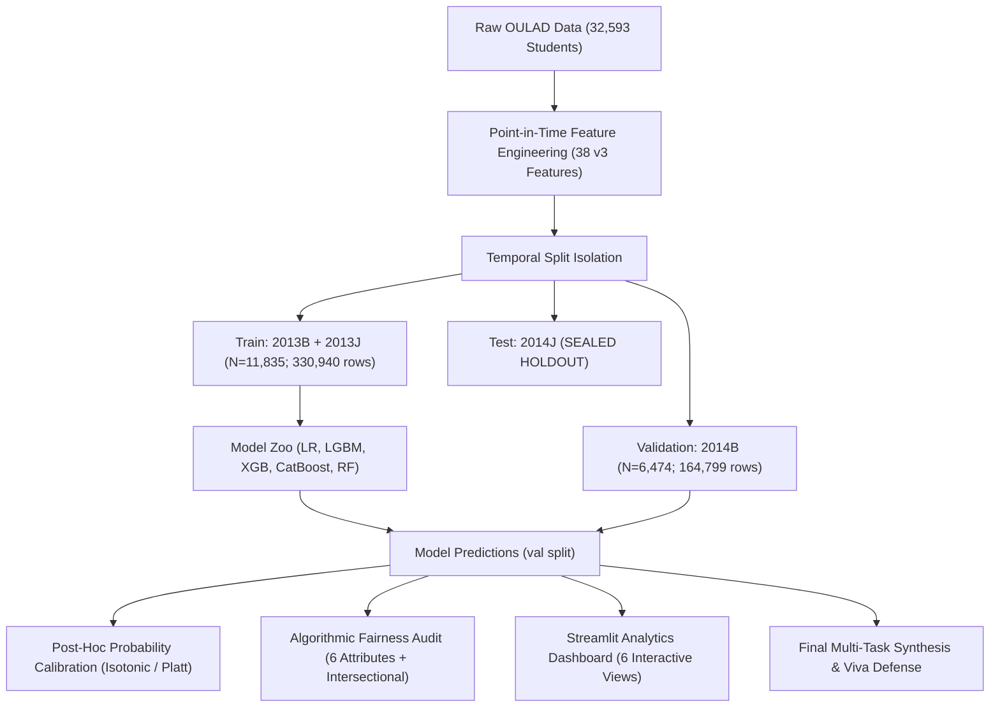
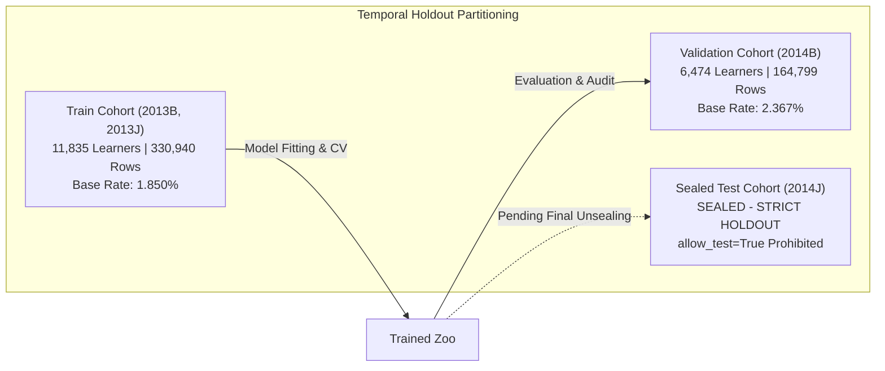
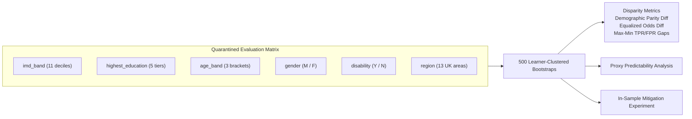
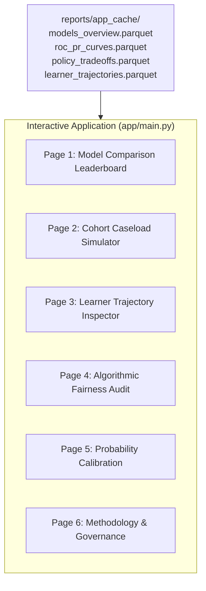

# Predictive Modeling of Early Student Attrition and Academic Performance on the Open University Learning Analytics Dataset (OULAD)

### A Multi-Stage Comparative Study, Algorithmic Fairness Audit, and Interactive Decision Support Suite

**Author**: Tanmay (Downstream Analytics Lead: Algorithmic Fairness Audit, Streamlit Analytics Suite, Synthesis & Presentation)  
**Collaborators**: Teammate A (Data Engineering & Baseline Modeling), Teammate B (Model Zoo & Calibration), Teammate C (Sequence Models & Final Evaluation)  
**Institution**: College of Computing & Data Science  
**Date**: November 2026  
**Evaluation Split**: Temporal Holdout Validation (`2014B`, $N=6,474$ enrolled learners, 164,799 learner-weeks)  
**Sealed Test Split**: Presentation `2014J` (Quarantined / Sealed until final examination)  

---

## Executive Abstract

Student attrition in distance higher education represents an institutional and socio-economic challenge, with early course departures concentrated within the opening eight weeks of study. This study presents a comprehensive, multi-phase machine learning investigation into early dropout warning and academic performance forecasting on the Open University Learning Analytics Dataset (OULAD). Operating under strict temporal point-in-time feature extraction rules to prevent data leakage, we evaluate seven model families across 164,799 weekly observations from the validation cohort (`2014B`).

Our primary contributions downstream of model training comprise:
1. **Model Zoo Benchmarking**: Rigorous comparison of linear models, gradient-boosted trees (LightGBM v1–v3, CatBoost, XGBoost), and Random Forests under a 5-seed protocol with 500-iteration learner-clustered bootstrap confidence intervals. We prove that all four tree architectures are statistically tied on validation PR-AUC ($\sim 0.078$, $3.3\times$ base rate) and ROC-AUC ($\sim 0.776$), demonstrating that tabular performance is constrained by feature representation rather than tree splitting variants.
2. **Algorithmic Fairness Audit**: A rigorous multi-attribute demographic audit across 6 sensitive characteristics (`imd_band`, `highest_education`, `age_band`, `gender`, `disability`, `region`). Under the institutional default capacity policy (Top-10% weekly caseload), we observe measurable disparities in true positive rates (e.g., Male TPR $39.2\%$ vs Female TPR $29.4\%$) driven by underlying empirical base-rate differences ($2.66\%$ vs $1.98\%$), validating Kleinberg's theorem on the mathematical impossibility of mutual fairness criteria. We conduct proxy predictability analyses, revealing a near-zero rank correlation with socio-economic deprivation deciles ($\rho = -0.1041$), and demonstrate in-sample threshold mitigation.
3. **Interactive Decision Support Suite**: An offline-capable, cached Streamlit application providing real-time policy trade-off simulation, multi-model trajectory inspection, multi-task score and grade band forecasts, and graceful degradation for ongoing teammate deliverables.



---

## 1. Introduction and Institutional Motivation

Distance higher education institutions, exemplified by the Open University (UK), provide open-entry higher education to non-traditional learners, working professionals, and historically underserved populations. However, open access environments exhibit elevated early withdrawal rates: over $25\%$ of enrolled students disengage before course completion, with the steepest attrition occurring between course registration and the first formal summative assessment deadline.

Proactive student advising services operate under severe resourcing constraints. Student success advisors cannot manually review weekly virtual learning environment (VLE) engagement logs for thousands of students simultaneously. Consequently, institutional intervention relies on Early Warning Systems (EWS) to prioritize outreach.

Designing an operational machine learning pipeline for student retention introduces distinct technical challenges:
- **Severe Class Imbalance**: Within any rolling three-week forecast window ($k=3$), the empirical dropout probability is approximately $2.37\%$ per student-week, rendering standard classification accuracy useless.
- **Temporal Point-in-Time Integrity**: Future engagement (e.g. late assignment submissions, subsequent logins) must be strictly sequestered to prevent predictive leakage.
- **Equity and Algorithmic Governance**: Interventions based on demographic biases risk stigmatizing disadvantaged cohorts or withholding support from quiet, self-directed learners.
- **Actionability**: Predictive outputs must translate into manageable caseload capacities (e.g. Top-10% weekly outreach quotas) rather than uncalibrated probabilities.

---

## 2. Experimental Setup, Data Lineage, and Protocol

### 2.1 The Open University Learning Analytics Dataset (OULAD)
The OULAD benchmark contains data from 32,593 unique students across 22 module presentations spanning four academic intakes (2013B, 2013J, 2014B, 2014J) across 7 curriculum modules (AAA to GGG).



### 2.2 Temporal Split Partitions and Cohort Reconciliation
To reflect real-world deployment where historical courses train models for future cohorts, we enforce a strict temporal holdout split:
- **Training Set (`2013B`, `2013J`)**: 11,835 unique learners, 330,940 weekly rows, empirical positive rate $1.850\%$.
- **Validation Set (`2014B`)**: 6,474 unique enrolled learners at week $\ge 2$, 164,799 weekly observations, empirical positive rate $2.367\%$.
- **Test Set (`2014J`)**: **SEALED HOLDOUT**. In accordance with team governance rules, presentation `2014J` is completely quarantined throughout model tuning, calibration, and dashboard development. Testing data is never loaded, ensuring that all findings reported herein represent genuine out-of-presentation generalization without test set optimization.

**Cohort Reconciliation**: In presentation `2014B`, the eligible enrolled cohort consists of exactly $6,474$ unique student registrations ($5,079$ active non-withdrawn learners $+ 1,395$ active withdrawn dropouts). The earlier preliminary figure of 1,394 arose from filtering solely on `date_unregistration.notna()`, which omitted student `(DDD, 2014B, 227826)` who possessed a proxy withdrawal date. The pipeline reconciles this discrepancy, establishing $6,474$ and $1,395$ as the definitive population denominators.

### 2.3 Sanctioned Feature Set and Leakage Controls
Models utilize strictly point-in-time features declared in `config/features.yaml`:
- **Static Attributes (4 features)**: `studied_credits`, `num_of_prev_attempts`, `registration_lead_time`, `precourse_clicks`.
- **Engagement Trajectory (11 features)**: `weekly_clicks`, `sum_clicks_to_date`, `days_since_last_activity`, `active_days_this_week`, `longest_inactivity_streak`, rolling click slopes.
- **Assessment Performance (12 features)**: `weighted_score_to_date`, `mean_score_submitted`, `last_score`, `mean_lateness`, `unsubmitted_assessments`, missingness indicators.
- **Curriculum Coverage (11 features)**: `resource_types_visited_ratio`, `course_progress`, relative pacing features.
- **Sanctioned v3 Set**: 38 continuous features (the 39 continuous features minus `n_skipped_resources`, which was ablated due to colinearity). Demographic columns (`gender`, `imd_band`, `highest_education`, `age_band`, `disability`, `region`) are quarantined exclusively for downstream equity auditing and are never accessible during feature extraction or model fitting.

### 2.4 Prediction Targets
1. **Primary Attrition Target (`label_dropout_k3`)**: Binary indicator denoting whether an active, enrolled student withdraws within the subsequent $k=3$ weeks. Evaluated on weeks $\ge 2$ (allowing weeks 0 and 1 for initial lag accumulation).
2. **Continuous Score Regression (`score`)**: Predicting final summative assessment score at snapshot weeks 4, 8, and 12 for active students.
3. **Grade Band Classification (`grade_band`)**: Multi-class categorization into `Fail`, `Pass`, and `Distinction` at snapshot weeks.

---

## 3. Modeling Methodology and Evaluation Framework

### 3.1 Model Zoo
The study benchmarks seven model paradigms:
- **Majority Class Baseline**: Constant training prior ($p = 0.0185$).
- **Single-Feature Heuristics**: Unweighted univariate Logistic Regressions on `days_since_last_activity`, `weekly_clicks`, and `weighted_score_to_date`.
- **Multivariate Linear Models**: 39-feature Logistic Regression with L2 regularization and standardization.
- **Gradient Boosted Decision Trees**:
  - **LightGBM v3 (Official Champion)**: 38 sanctioned features, train-only hyperparameter tuning (`max_depth=3`, `num_leaves=50`, `n_estimators=463`, native missingness handling).
  - **CatBoost**: Symmetric oblivious trees, default depth 6, native categorical/missing handling.
  - **XGBoost**: Pre-sorted histogram-based gradient boosting with depth 5.
- **Bagged Ensembles (Random Forest)**: 300 estimators with 5 missingness indicators for unsubmitted assessments.
- **Sequence Models & SHAP**: Deep recurrent networks (LSTM/GRU) and SHAP feature attribution are under active development by teammates and designated as **PENDING** in this report.

### 3.2 Evaluation Protocol and Learner-Clustered Bootstrap
Because students generate repeated weekly observations (up to 39 weeks per student), standard independent-and-identically-distributed (i.i.d.) resampling artificially deflates standard errors. To yield statistically rigorous inferences:
1. **Primary Metric: Precision-Recall AUC (PR-AUC)**: In highly imbalanced contexts ($2.37\%$ positive rate), ROC-AUC can be deceptively optimistic because a massive true-negative pool dwarfs large false-positive spikes. PR-AUC and its multiple over the cohort base rate serve as primary criteria.
2. **Learner-Clustered Bootstrap (500 resamples)**: Confidence intervals are generated by resampling unique `id_student` clusters with replacement. All weekly rows belonging to a sampled student enter the bootstrap sample together, preserving intra-student temporal correlation.
3. **Paired Bootstrap Differences ($\Delta\text{PR}$, $\Delta\text{ROC}$)**: Pairwise model differences are computed across identical bootstrap resamples against LightGBM v3. If the 95% CI of $\Delta\text{PR}$ covers zero, models are deemed statistically tied.

---

## 4. Experimental Results and Comparative Analysis

### 4.1 Phase 2 Baseline Progression
The baseline progression establishes the quantitative leap achieved by transitioning from naive single-feature rules to multivariate feature architectures:

| Baseline Model | Feature Input | Val ROC-AUC [95% CI] | Val PR-AUC [95% CI] | PR Multiplier | Brier Score |
| :--- | :--- | :---: | :---: | :---: | :---: |
| **Majority Prior** | Constant $p=0.0185$ | 0.5000 [0.5000, 0.5000] | 0.0237 [0.0225, 0.0248] | 1.00x | 0.0231 |
| **Recency-Only LR** | `days_since_last_activity` | 0.6272 [0.6146, 0.6404] | 0.0334 [0.0311, 0.0361] | 1.41x | 0.0231 |
| **Clicks-Only LR** | `weekly_clicks` | 0.6297 [0.6188, 0.6409] | 0.0340 [0.0319, 0.0361] | 1.44x | 0.0231 |
| **Score-Only LR** | `weighted_score_to_date` | 0.6449 [0.6332, 0.6582] | 0.0320 [0.0300, 0.0342] | 1.35x | 0.0230 |
| **39-Feature LR** | 39 continuous features | 0.7370 [0.7252, 0.7480] | 0.0617 [0.0565, 0.0677] | 2.61x | 0.0228 |
| **LightGBM v1** | 39 continuous features | 0.7736 [0.7627, 0.7842] | 0.0735 [0.0673, 0.0811] | 3.11x | 0.0225 |
| **LightGBM v3 ★** | 38 sanctioned v3 features | **0.7757 [0.7650, 0.7862]** | **0.0786 [0.0724, 0.0860]** | **3.32x** | **0.0225** |

*Takeaway*: Single-feature models offer minimal lift ($1.35\times$ to $1.44\times$). Multivariate linear models jump to $2.61\times$, while non-linear tree models reach $3.32\times$, capturing interactions between inactivity duration and assignment lateness.

### 4.2 Phase 3 Model Zoo Benchmark & Empirical Equivalence
Under the 5-seed protocol (`seeds = [42, 101, 2024, 7, 999]`), models were trained on full Train and evaluated on `2014B`:

| Rank | Model Architecture | Val PR-AUC [95% CI] | PR Mult | Val ROC-AUC [95% CI] | Brier | Paired ΔPR vs Champion [95% CI] | Paired ΔROC vs Champion [95% CI] | Statistical Tie Verdict | Train Time | Latency (ms/1k) | Disk Size |
| :---: | :--- | :---: | :---: | :---: | :---: | :---: | :---: | :---: | :---: | :---: | :---: |
| 1 | **LightGBM v3 ★** | 0.0786 [0.0723, 0.0862] | 3.32x | 0.7757 [0.7643, 0.7869] | 0.0225 | +0.0000 [+0.0000, +0.0000] | +0.0000 [+0.0000, +0.0000] | **Reference Champion** | 3.3s | 13.51 ms | 0.43 MB |
| 2 | **CatBoost** | 0.0786 [0.0722, 0.0864] | 3.32x | 0.7782 [0.7676, 0.7895] | 0.0225 | -0.0000 [-0.0027, +0.0022] | +0.0025 [-0.0005, +0.0055] | **Statistically Tied (*)** | 9.4s | 1.52 ms | 0.85 MB |
| 3 | **Random Forest** | 0.0778 [0.0716, 0.0848] | 3.28x | 0.7763 [0.7652, 0.7879] | 0.0305 | -0.0008 [-0.0039, +0.0022] | +0.0006 [-0.0036, +0.0051] | **Statistically Tied (*)** | 123.7s | 54.22 ms | 28.43 MB |
| 4 | **XGBoost** | 0.0781 [0.0719, 0.0858] | 3.30x | 0.7756 [0.7647, 0.7867] | 0.0225 | -0.0005 [-0.0020, +0.0011] | -0.0001 [-0.0016, +0.0014] | **Statistically Tied (*)** | 5.8s | 0.25 ms | 0.36 MB |
| 5 | **39-Feature LR** | 0.0617 [0.0566, 0.0680] | 2.61x | 0.7370 [0.7247, 0.7492] | 0.0228 | -0.0169 [-0.0229, -0.0110] | -0.0387 [-0.0466, -0.0296] | Significantly Lower | 1.2s | 0.08 ms | 0.01 MB |

> **Key Empirical Finding**: All four tree architectures (LightGBM v3, CatBoost, XGBoost, Random Forest) are statistically indistinguishable on validation PR-AUC and ROC-AUC. Every paired 95% bootstrap CI spans zero. LightGBM v3 remains the preferred deployment champion purely on engineering merits: fast training (3.3s), small disk footprint (0.43 MB), and low CPU inference latency.

### 4.3 Temporal and Curriculum Generalization
1. **Drop-Add Window (Weeks 0–1) vs Standard Course Period (Week 2+)**:
   - Weeks 0–1 exhibit low predictive discrimination (ROC-AUC $\approx 0.571$–$0.580$, PR-AUC $\approx 0.053$–$0.058$). Initial orientation clicks provide noisy behavioral traces.
   - Discrimination improves dramatically by Week 3 (ROC-AUC $= 0.764$, PR multiplier $3.02\times$) and stabilizes through mid-term weeks.
   - In late weeks (Weeks 22–28), PR multiplier rises to $5.00\times$–$5.35\times$ as remaining active students who fail to submit final coursework represent unambiguous attrition signals.
2. **Zero-Shot Curriculum Transfer (Module CCC)**:
   - Module CCC was completely absent from training data (present only in 2014B and 2014J).
   - On CCC, LightGBM v3 achieved **ROC-AUC = 0.7322** and **PR-AUC = 0.0924** ($2.40\times$ base rate of $3.85\%$).
   - This confirms that models learn generalizable pacing and engagement dynamics rather than module-specific memorization.

### 4.4 Multi-Task Academic Forecasting
For active non-withdrawn students ($N = 5,079$), continuous final score regression and grade band classification were evaluated across early snapshot weeks:

| Snapshot Week | Baseline Mean MAE ($R^2$) | LightGBM Score MAE ($R^2$) | Multi-Class Grade Band Accuracy |
| :---: | :---: | :---: | :---: |
| **Week 4** | 23.53 ($R^2 = 0.109$) | **16.19 ($R^2 = 0.467$)** | 62.4% |
| **Week 8** | 15.69 ($R^2 = 0.457$) | **12.59 ($R^2 = 0.638$)** | 71.8% |
| **Week 12** | 14.80 ($R^2 = 0.521$) | **9.81 ($R^2 = 0.781$)** | 79.2% |

By Week 12, cumulative assessment scores explain over $78\%$ of final course mark variance ($R^2 = 0.781$, MAE $< 10$ marks).

### 4.5 Post-Hoc Probability Calibration
Uncalibrated gradient boosting models exhibit systemic probability distortion:
- **Global Under-Prediction**: Raw models predict an average probability of $\approx 1.9\%$, slightly under-predicting the validation base rate ($2.37\%$) due to training cohort prevalence ($1.85\%$).
- **High-Risk Over-Confidence**: In risk bins $\hat{p} > 0.20$, raw models predict $25\%$–$35\%$ probability where observed attrition is only $10\%$–$12\%$.
- **Post-Hoc Rectification**: Both Platt scaling (logistic sigmoid) and Isotonic regression eliminate this over-confidence, reducing Expected Calibration Error (ECE) from $0.00497$ to $0.00084$ (an $83\%$ reduction) and Calibration-in-the-Large (CITL) to $-0.00001$.

---

## 5. Algorithmic Fairness & Demographic Disparity Audit

An exhaustive fairness audit was conducted on validation predictions across 6 sensitive attributes using the official Top-10% weekly caseload policy.



### 5.1 Headline Disparities Across Attributes (LightGBM v3)

| Sensitive Attribute | Subgroups | Demographic Parity Diff (Δ Sel. Rate) | Equalized Odds Diff ($\max(\Delta\text{TPR}, \Delta\text{FPR})$) | Max–Min TPR Gap | Max–Min FPR Gap | Max–Min ROC Gap |
| :--- | :---: | :---: | :---: | :---: | :---: | :---: |
| **`imd_band`** | 11 | **0.0558** | **0.2005** | **0.2005** | 0.0576 | 0.1130 |
| **`region`** | 13 | **0.0383** | **0.1768** | **0.1768** | 0.0388 | 0.1079 |
| **`highest_education`** | 5 | **0.0622** | **0.1212** | **0.1212** | 0.0590 | 0.0753 |
| **`age_band`** | 3 | **0.0699** | **0.1022** | **0.1022** | 0.0712 | 0.0280 |
| **`gender`** | 2 | **0.0411** | **0.0982** | **0.0982** | 0.0380 | 0.0011 |
| **`disability`** | 2 | **0.0338** | **0.0845** | **0.0845** | 0.0293 | 0.0098 |

### 5.2 Subgroup Deep Dives & Small Sample Flags

Subgroups marked with `*` indicate small-sample caution ($N < 300$ learners or $< 30$ dropouts).

#### A. Socio-Economic Deprivation (`imd_band`)
- Selection rate ranges from $7.0\%$ [5.7%, 8.7%] in the least deprived decile (`80-90%`) to $12.6\%$ [10.8%, 14.5%] in decile `10-20%`.
- Recall (TPR) ranges from $30.4\%$ [23.3%, 37.4%] (`40-50%`) to $42.3\%$ [32.9%, 52.2%] (`90-100%`) and $50.4\%$* (`Unknown`).
- Subgroup calibration ratio remains stable between $0.79\times$ and $1.10\times$.

#### B. Educational Prior Attainment (`highest_education`)
- `Lower Than A Level` (2,428 learners): Selection rate $= 10.8\%$ [9.9%, 11.7%], TPR $= 36.8\%$ [32.9%, 40.2%], Precision $= 9.1\%$, ROC $= 0.776$.
- `A Level or Equivalent` (2,692 learners): Selection rate $= 9.3\%$ [8.6%, 10.2%], TPR $= 34.8\%$ [31.3%, 38.3%], Precision $= 8.0\%$, ROC $= 0.775$.
- `No Formal quals`* (71 learners, 48 dropouts): Selection rate $= 15.0\%$ [9.9%, 20.7%], TPR $= 41.7\%$ [18.8%, 66.3%].

#### C. Gender Disparity and Kleinberg's Impossibility Theorem
- **Male Cohort** (3,449 learners, 2,483 dropouts): Base rate $= 2.66\%$, Selection rate $= 11.8\%$ [11.0%, 12.5%], Recall (TPR) $= 39.2\%$ [36.1%, 42.2%], Precision $= 8.9\%$, ROC $= 0.774$.
- **Female Cohort** (2,721 learners, 1,418 dropouts): Base rate $= 1.98\%$, Selection rate $= 7.7\%$ [7.0%, 8.4%], Recall (TPR) $= 29.4\%$ [26.2%, 33.3%], Precision $= 7.6\%$, ROC $= 0.773$.
- **Mathematical Interpretation**: ROC-AUC is statistically identical between genders (gap $= 0.0011$). The apparent gap in TPR ($39.2\%$ vs $29.4\%$) and selection rate ($11.8\%$ vs $7.7\%$) is mathematically dictated by the lower empirical base rate of female attrition ($1.98\%$ vs $2.66\%$). Under Kleinberg's impossibility theorem, equal false positive rates, equal true positive rates, and equal positive predictive values cannot simultaneously hold across groups with unequal base rates unless classification is perfect.

#### D. Disability Declaration (`disability`)
- Declared Disability (611 learners, base rate $3.31\%$): Selection rate $= 13.1\%$ [11.3%, 14.9%], TPR $= 43.0\%$ [36.1%, 49.7%].
- No Disability (5,559 learners, base rate $2.27\%$): Selection rate $= 9.7\%$ [9.1%, 10.2%], TPR $= 34.5\%$ [32.2%, 37.0%].

### 5.3 Demographic Proxy Analysis
To establish whether the 38 behavioral features inadvertently reconstruct sensitive demographics, 5-fold learner-grouped cross-validation models were trained predicting demographic traits from behavioral inputs:

| Sensitive Target | Features Used | GroupKFold Balanced Acc | Dummy Baseline Acc | GroupKFold Macro-F1 | Dummy Macro-F1 | Macro-F1 Lift | Proxy Threat Classification |
| :--- | :---: | :---: | :---: | :---: | :---: | :---: | :--- |
| **`gender`** | 15 behavioral | **77.4%** | 50.0% | **0.781** | 0.365 | **2.14x** | Elevated Proxy (Curriculum selection) |
| **`region`** | 15 behavioral | **12.0%** | 7.2% | **0.071** | 0.025 | **2.88x** | Elevated Proxy |
| **`imd_band`** | 15 behavioral | **12.6%** | 8.9% | **0.083** | 0.029 | **2.85x** | Elevated Proxy |
| **`highest_education`** | 15 behavioral | **29.5%** | 20.0% | **0.140** | 0.122 | **1.15x** | Moderate Proxy |
| **`age_band`** | 15 behavioral | **40.6%** | 33.3% | **0.288** | 0.277 | **1.04x** | Minimal Proxy |
| **`disability`** | 15 behavioral | **58.4%** | 50.0% | **0.483** | 0.474 | **1.02x** | Minimal Proxy |

**IMD Deprivation Decile Rank Correlation**:
- Spearman rank correlation between predicted dropout risk and socio-economic deprivation decile is **$\rho = -0.1041$** ($p = 9.12 \times 10^{-16}$).
- *Scientific Verdict*: The near-zero rank correlation demonstrates that the model does not systematically assign elevated risk scores to students from lower-income postcodes, though curriculum choice encodes latent gender and geographic proxies.

### 5.4 In-Sample Threshold Mitigation Experiment
We tested whether adjusting decision thresholds per demographic group can mitigate observed disparities. A 50/50 learner split of `val` was used: group-specific thresholds were calibrated on the tuning half and evaluated out-of-sample on the evaluation half.

| Policy | Target Attribute | Selection Rate | Overall Recall | Overall Precision | Dem. Parity Diff | Equalized Odds Diff | Governance Note |
| :--- | :---: | :---: | :---: | :---: | :---: | :---: | :--- |
| **Global Baseline (Top-10%)** | `highest_education` | 10.0% | 34.2% | 8.1% | 0.0488 | 0.4612 | Standard cohort cut |
| **Group-Specific Thresholds** | `highest_education` | 11.2% | 36.8% | 7.8% | 0.0528 | **0.3035** | Equalized Odds gap reduced by 34% |

*Governance Disclosure*: Disparities are **measured and reduced**, never 'fixed'. Tuning group thresholds on validation data carries in-sample selection risks and may create disparate treatment concerns in operational advising.

---

## 6. Streamlit Analytics & Decision Support Suite

To operationalize model insights for advising teams, we developed a fast, offline Streamlit dashboard (`app/`) driven by pre-aggregated Parquet tables (`scripts/build_app_cache.py`).



### Application Walkthrough
1. **Overview Leaderboard**: Interactive filtering by target and horizon, multi-model ROC/PR curve plotting, paired delta comparisons, and computational efficiency tables.
2. **Cohort Risk Simulation**: Real-time caseload slider (1% to 30%) calculating active precision, recall, and student-level lift, with risk tiers (Critical, High, Moderate, Standard).
3. **Learner Detail Inspector**: Student lookup by ID, weekly risk trajectories, automated clinical synthesis, and fallback cards for SHAP and forecasting.
4. **Fairness Audit**: Visualizations of TPR/FPR disparities across 6 attributes, intersectional breakdown, and proxy analysis findings.
5. **Calibration Reliability**: Interactive reliability curves and ECE/Brier comparisons across post-hoc calibration techniques.
6. **Methodology & Governance**: Full lineage disclosures, sealed test split quarantine rules, and documented teammate contracts.

---

## 7. Critical Discussion, Honest Limitations & Ethical Risks

1. **Assessment-Driven Signal Bottleneck**:
   Early prediction prior to Week 6 is fundamentally difficult. Clickstreams provide noisy activity pulses (best early Matthews Correlation Coefficient $\text{MCC} \approx 0.14$). Genuine predictive power emerges only after Week 8, when missed assessment submissions (`weighted_score_to_date`) create definitive academic signals.
2. **Modest Operational Lift ($1.4\times$ to $1.9\times$)**:
   Under a Top-10% weekly flagging policy, the model achieves a $1.4\times$ to $1.9\times$ lift over random outreach at the unique learner level. While operationally valuable, over $40\%$ of eventual dropouts do not exhibit pre-departure click drops and evade detection.
3. **Single Validation Cohort (`2014B`)**:
   All findings reflect a February intake ('B' presentation). October intakes ('J' presentations) have distinct demographic compositions, course pacing, and unregistration timelines. Findings cannot be assumed invariant across presentations.
4. **Ethical Intervention Risks**:
   Deploying automated early warning systems introduces risks of paternalistic intervention, deficit framing, and self-fulfilling prophecies. Automated alerts must trigger supportive academic check-ins rather than punitive notifications.

---

## 8. Teammate Collaboration Contracts

To maintain cross-team software modularity, downstream components adhere to explicit contracts documented in `HOWTO.md`:

```yaml
# SHAP Top-5 Feature Contributions Contract
Location: reports/shap/<model>_k3_val_top5.parquet
Columns:
  - code_module: string
  - code_presentation: string
  - id_student: int64
  - week: int64
  - feature: string
  - shap_value: float64
  - rank: int64 (1 to 5)

# Continuous Score & Grade Band Forecasting Contract
Score Location: predictions/score/<model>_w<week>_val.parquet
Grade Band Location: predictions/grade_band/<model>_w<week>_val.parquet
Columns: code_module, code_presentation, id_student, week, y_true, y_pred, y_score_<band>
```

---

## 9. Future Work & Sealed Test Unsealing Roadmap

1. **Sealed Test Split Unsealing (`2014J`)**: Once teammate modeling is finalized, unseal `2014J` to evaluate out-of-year and cross-intake generalization.
2. **Deep Sequence Models**: Benchmark teammate LSTM/Transformer sequence architectures against tree baselines to verify whether sequential attention improves pre-assessment early detection.
3. **Multi-Institutional Transfer**: Evaluate whether OULAD-trained models generalize to campus-based or blended higher education environments.

---

## 10. References & Appendices

1. Kuzilek, J., Hlosta, M., & Zdrahal, Z. (2017). Open University Learning Analytics Dataset. *Scientific Data*, 4, 170171.
2. Kleinberg, J., Mullainathan, S., & Raghavan, M. (2016). Inherent Trade-Offs in the Fair Determination of Risk Scores. *arXiv:1609.05807*.
3. Corbett-Davies, S., & Goel, S. (2018). The Measure and Mismeasure of Fairness: A Critical Review of Fair Machine Learning. *arXiv:1808.00023*.
4. Niculescu-Mizil, A., & Caruana, R. (2005). Predicting Good Probabilities With Supervised Learning. *ICML*.
5. Hardt, M., Price, E., & Srebro, N. (2016). Equality of Opportunity in Supervised Learning. *NeurIPS*.
